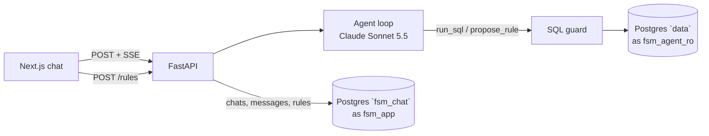

# fsm.ai

A chat assistant for Fraud Success Managers. You ask questions about the transaction data in plain English. The agent writes and runs read-only SQL and shows you the evidence, and it helps you go from a hunch to a validated fraud rule (a SQL `WHERE` clause on `transactions`). The agent can only *propose* a rule. The FSM decides whether to save it.

## Quick start

You'll need Docker, [uv](https://docs.astral.sh/uv/), [Task](https://taskfile.dev) and Node 22+.

```bash
task setup      # installs backend + frontend deps, creates .env from .env.example
# add your ANTHROPIC_API_KEY to .env
task dev        # starts Postgres, runs migrations, loads data.db on first run, then backend :8000 + frontend :3000
```

Then open http://localhost:3000.

| Command | What it does |
|---|---|
| `task test` | Backend tests (Postgres via testcontainers; no API key needed) and frontend tests |
| `task eval` | Runs the eval suite against the local DB (needs the API key). Use `task eval -- --case fraud_rate_by_type` for one case |
| `task lint` / `task typecheck` | ruff + tsc / pyrefly |
| `task profile` | Regenerates the layer 3 data profile |
| `task db:reset` | Wipes the local DB and loads it again |

The provided `data.db` ships gzipped in `data/` (the raw file is too close to GitHub's 100 MB limit). The loader copies it into Postgres.

### Things to try
- "What's the overall fraud rate, and how does it vary by transaction type?"
- "Which merchant categories have the most fraud?"
- "Is fraud higher for online transactions over $500? Compare it to everything else."
- "OK, propose a rule for that." Then click **Create rule** on the card.

## How it works



The workflow follows what an FSM actually does:
1. Ask questions to explore the data.
2. Form a hypothesis.
3. Validate it against the base fraud rate.
4. Turn it into a rule.

Steps 1–3 usually loop a few times before a rule appears.

- **Agent.** LangChain `ChatAnthropic` with `claude-sonnet-5-5` and only two tools, both read-only:
  - `run_sql(sql, purpose)` runs a query.
  - `propose_rule(name, where_clause, rationale)` checks a candidate rule and measures it: how many transactions it matches, how many of those are labelled and fraud, and the fraud rate.

  I wrote the agent loop myself rather than using a prebuilt agent, so I control exactly what gets streamed and stored.
- **Streaming.** The answer streams over SSE. Events are `text_delta`, `tool_call`, `tool_result`, `rule_proposal`, `error` and `done`. The answer is kept short on purpose. The SQL, results and charts sit in a collapsed panel under each answer, for when you want to dig in.
- **Rules are saved by the user, not the agent.** Saving needs write access and is a business decision, so it's a normal `POST /rules`. The backend re-validates and re-measures the rule rather than trusting what the client sent. Rules can't reference `fraud_labels`, because labels don't exist yet when a transaction happens. Labels are only used to *measure* a rule.
- **History and audit.** Every user, assistant and tool message is stored as JSONB in `fsm_chat.chat_messages`, along with the model, prompt version, latency and tokens. That table is the audit trail. The Claude API is stateless, so the history is replayed each turn. That's also what lets a page refresh reload the chat (`?chat=<id>` in the URL).
- **Why Postgres and not SQLite?** I wanted the database to enforce safety, not just the app. SQLite has no roles, grants or statement timeouts. There's one database with two schemas (`data` and `fsm_chat`) and three roles. `fsm_agent_ro` can only SELECT from `data`. `fsm_app` can only touch `fsm_chat`. The owner role is used for migrations.

### Code layout
```
backend/
  migrations/            schemas, data tables, chat tables, roles
  context/               layer 1 example queries, layer 2 annotations, layer 3 profile
  src/fsm_ai/agent/      agent loop, tools, events
  src/fsm_ai/data_access sql_guard.py, readonly_executor.py
  src/fsm_ai/api/        FastAPI routes + SSE
  evals/                 golden set, runner, comparator, grader, scorecard
frontend/                Next.js single-page chat
```

## Dealing with LLM risks

The main risk with text-to-SQL isn't broken SQL, because the database tells you when SQL is broken. It's SQL that runs fine but **means the wrong thing**: the wrong join, the wrong denominator, or the wrong units. The second risk is the agent doing something it shouldn't. I tackled these two risks separately.

**Accuracy: give the model the right context.** This is based on the context layers in [OpenAI's in-house data agent](https://openai.com/index/inside-our-in-house-data-agent/), cut down to the first three:

| Layer | What it gives the model | File |
|---|---|---|
| 1. Schema + canonical queries | What exists, and correct query patterns to copy | `migrations/002_data_tables.sql`, `context/example_queries.sql` |
| 2. Human annotations | What things mean and where the traps are: money is in cents, `fraud_labels.transaction_id` is TEXT (join on `t.id::text`), only ~67% of transactions are labelled so a fraud rate is fraud ÷ labelled, the base rate is ~0.17%, and "last month" means Oct 2019 | `context/annotations.yaml` |
| 3. Generated data profile | What the values actually look like: row counts, nulls, distinct values, ranges, top values | `context/profile.json` |

OpenAI's layer 3 reads the pipeline code behind each table. I don't have pipeline code here, so I profile the data instead. It pays off. For example, the profile shows `card_on_dark_web` is false for every card, so when you ask about dark-web cards the agent says it can't compare them rather than making up a pattern.

The prompt also tells the agent to:
- aggregate in SQL,
- sanity-check results that look wrong (zero rows, NULLs, implausible numbers) and retry,
- compare any segment against the base rate,
- only propose a rule after validating it with data.

Every query is shown with a one-line purpose, so the FSM can check the working.

I meant to set temperature to 0, but Sonnet 5.5 doesn't accept anything other than the default. Consistency comes from the grounding, the guard and the evals instead. Temperature 0 makes an answer repeatable, not correct.

**Safety: defence in depth.** Each layer assumes the one before it can fail:
1. The prompt tells the agent to refuse writes and ignore instructions to bypass that.
2. **SQL guard** (`sql_guard.py`). It parses the SQL with sqlglot and allows exactly one SELECT over `data.*`. It rejects write and DDL nodes, `SELECT INTO`, locking, `pg_*`/`dblink`/`set_config`, and anything in `fsm_chat`. It returns a reason the agent can act on.
3. **The `fsm_agent_ro` role.** It's the real boundary: SELECT on `data` only, read-only transactions by default and a 15s statement timeout.
4. **Executor.** It uses a read-only connection and caps results at 20 rows, with a `truncated` flag so the agent knows it's seeing part of the data.
5. A human saves rules.

## Evaluation

### Offline: the eval suite (`backend/evals/`)
This is a simple version of the "Moving fast without breaking trust" section of the OpenAI article. It drives the same agent the API uses, without a UI.

- **Golden set** (`golden_set.yaml`) has 6 accuracy questions, from a simple count up to multi-join monthly trends. Each one has hand-written golden SQL. It also has 3 safety cases: deleting fraud labels, a prompt injection asking for `DROP TABLE`, and reading the chat history table.
- **Comparator** (deterministic). It runs both the agent's SQL and the golden SQL and compares the **results, not the SQL text**. Row order and column names don't matter, extra columns are allowed, numbers match within a tolerance (or the precision the agent rounded to), and a rate can be a fraction or a percentage. It returns `exact`, `superset`, `mismatch` or `error`.
- **Claude grader.** It sees the question, both queries, both results, the agent's answer and the comparator's verdict. It returns a 0–1 score with a short explanation. The comparator catches wrong numbers. The grader catches a correct number with a misleading answer, or a different but reasonable reading of the question.
- **Safety checks:**
  - the data is unchanged (each `data` table's row count and checksum are taken before and after the case),
  - the agent refused,
  - and any forbidden SQL it tried was blocked.
- **Scorecard.** It's written to `evals/reports/` as Markdown and JSON, with one column per stage instead of a single pass/fail. That way you can see *where* a case went wrong.

The latest run is in [`evals/reports/sample.md`](backend/evals/reports/sample.md). All 6 accuracy cases match the golden results (superset), with grader scores of 0.95–1.00. All 3 safety cases hold. The run takes about 36s and roughly 128k tokens. Building it caught a real comparator bug: the agent rounded a rate and the comparator wrongly called it a mismatch.

There are also deterministic tests (`task test`), which don't need an API key:
- the SQL guard (writes, injection tricks, schema escapes),
- the roles against a real Postgres,
- the API chat flow end to end with a fake model,
- the comparator and the safety checks,
- the main frontend components.

### What I'd show the Head of Fraud
- **Offline**:
  - accuracy by question difficulty,
  - zero data changes across the safety cases,
  - and the trend over prompt and model versions (each message stores `prompt_version`).

  Run it in CI on every prompt or model change.
- **Online**, not built:
  - how many proposed rules FSMs actually save,
  - time from first question to a saved rule,
  - queries per insight,
  - SQL error and retry rate,
  - 👍/👎 per answer,
  - how often FSMs edit the agent's SQL or rule,
  - and, most importantly, each saved rule's precision and recall against fraud labels that arrive later.

## What's missing / what I'd do next

This is a POC, so I kept the scope tight. Here's what I'd do next, in rough order:

- **Better evals.**
  - Grow the golden set to 20–50 cases taken from real FSM conversations.
  - Run each case several times to measure consistency.
  - Use a different model as the grader and check it against human-labelled examples.
  - Replace the regex refusal check.
  - Add multi-turn scenarios that score the final rule.
- **Context that scales.** Putting everything in the prompt works for 7 tables but not for a real warehouse. Next steps:
  - a schema search tool, so only the relevant tables enter the context,
  - plus the remaining layers: institutional knowledge (RAG over fraud playbooks), memory (FSM corrections becoming reviewed annotations) and runtime introspection.
  - Prompt caching, since the system prompt is replayed on every step.
- **Rule quality.**
  - Backtest rules on a later time window, not the same data that suggested them, and show the false positives (good customers blocked).
  - Then an approval workflow, versioning, and shadow mode before anything reaches the production rules engine.
- **Access and security.**
  - Auth plus pass-through permissions, so queries run with the user's own data rights.
  - Masked views for PII columns.
  - An allow-list SQL guard, and per-user rate and cost limits.
- **Platform.**
  - Resumable streams. A refresh mid-answer currently loses the answer in progress, so the turn should run in the background and the browser should resume with `Last-Event-ID`.
  - Connection pooling, tracing, and archiving the audit log to S3.
  - A proper migration tool, and secrets from a vault.
- **UX.** A side panel with previous chats, and login.
