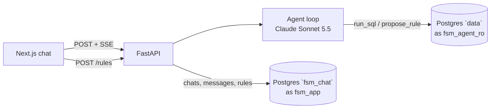

# fsm.ai

A chat assistant for Fraud Success Managers. You ask questions about the transaction data in plain English. The agent writes and runs read-only SQL and shows you the evidence, and it helps you go from a hunch to a validated fraud rule (a SQL `WHERE` clause on `transactions`). The agent can only *propose* a rule. The FSM decides whether to save it.

## Quick start

You'll need Docker, [uv](https://docs.astral.sh/uv/), [Task](https://taskfile.dev) and Node 22+.

```bash
task setup      # installs backend + frontend deps, creates .env from .env.example
# add your ANTHROPIC_API_KEY to .env
task dev        # starts Postgres, runs migrations, loads data.db on first run, then backend :8000 + frontend :3000
```

Then open http://localhost:3000.

| Command | What it does |
|---|---|
| `task test` | Backend tests (Postgres via testcontainers; no API key needed) and frontend tests |
| `task eval` | Runs the eval suite against the local DB (needs the API key). Use `task eval -- --case fraud_rate_by_type` for one case |
| `task lint` / `task typecheck` | ruff + tsc / pyrefly |
| `task profile` | Regenerates the layer 3 data profile |
| `task db:reset` | Wipes the local DB and loads it again |

The provided `data.db` ships gzipped in `data/` (the raw file is too close to GitHub's 100 MB limit). The loader copies it into Postgres.

### Things to try
- "What's the overall fraud rate, and how does it vary by transaction type?"
- "Which merchant categories have the most fraud?"
- "Is fraud higher for online transactions over $500? Compare it to everything else."
- "OK, propose a rule for that." Then click **Create rule** on the card.

## Code layout
```
backend/
  migrations/            schemas, data tables, chat tables, roles
  context/               layer 1 example queries, layer 2 annotations, layer 3 profile
  src/fsm_ai/agent/      agent loop, tools, events
  src/fsm_ai/data_access readonly_executor.py
  src/fsm_ai/api/        FastAPI routes + SSE
  evals/                 golden set, runner, comparator, grader, scorecard
frontend/                Next.js single-page chat
```

## How it works



The workflow follows what an FSM actually does:
1. Ask questions to explore the data.
2. Form a hypothesis.
3. Validate it against the base fraud rate.
4. Turn it into a rule.

Steps 1–3 usually loop a few times before a rule appears.

- **Agent.** LangChain `ChatAnthropic` with `claude-sonnet-5-5` and only two tools, both read-only:
  - `run_sql(sql, purpose)` runs a query.
  - `propose_rule(name, where_clause, rationale)` checks a candidate rule and measures it: how many transactions it matches, how many of those are labelled and fraud, and the fraud rate.
- **Streaming.** The answer streams over SSE, with these events:
  - `text_delta`
  - `tool_call`
  - `tool_result`
  - `rule_proposal`
  - `error`
  - `done`

  The answer is kept short on purpose. The SQL, results and charts sit in a collapsed panel under each answer, for when you want to dig in.
- **Rules are saved by the user, not the agent.** Saving needs write access and is a business decision, so it's a normal `POST /rules`. The backend re-validates and re-measures the rule rather than trusting what the client sent.
- **History and audit.** Every user, assistant and tool message is stored as JSONB in `fsm_chat.chat_messages`, along with the model, prompt version, latency and tokens. That table is the audit trail. The Claude API is stateless, so the history is replayed each turn. That's also what lets a page refresh reload the chat (`?chat=<id>` in the URL).
- **Why Postgres and not SQLite?** I wanted the database to enforce safety, not just the app. SQLite has no roles, grants or statement timeouts. There's one database with two schemas (`data` and `fsm_chat`) and three roles. `fsm_agent_ro` can only SELECT from `data`. `fsm_app` can only touch `fsm_chat`. The owner role is used for migrations.

### Frontend
- **Next.js, one screen.** It's a chat with a rules panel, which is all an FSM needs here. The chat id is in the URL, so a refresh rejoins the conversation.
- **The agent answers in Markdown.** LLMs write Markdown naturally, and it can be shown token by token as it streams. A JSON answer would have to finish before anything could be shown. Markdown also gives bold key figures and short lists for free.
- **Tables and charts are built from the real query results, not by the model.** The frontend turns each tool result into a Markdown table and a Mermaid chart, so the numbers on screen can't be hallucinated. They sit in a collapsed panel so the answer stays short.
- **[Streamdown](https://github.com/vercel/streamdown) for rendering.** It's a Markdown renderer built for streaming LLM output, and it copes with half-finished Markdown (unclosed bold, code blocks, tables) without the page flickering. Its plugins handle SQL highlighting and Mermaid charts.
- **`fetch` streaming instead of `EventSource`.** Sending a message is a POST, and `EventSource` only supports GET.

## Dealing with LLM risks

The main risk with text-to-SQL isn't broken SQL, because the database tells you when SQL is broken. It's SQL that runs fine but **means the wrong thing**: the wrong join, the wrong denominator, or the wrong units. The second risk is the agent doing something it shouldn't. I tackled these two risks separately.

**Accuracy: give the model the right context.** This is based on the context layers in [OpenAI's in-house data agent](https://openai.com/index/inside-our-in-house-data-agent/), cut down to the first three:

| Layer | What it gives the model | File |
|---|---|---|
| 1. Schema + canonical queries | What exists, and correct query patterns to copy | `migrations/002_data_tables.sql`, `context/example_queries.sql` |
| 2. Human annotations | What things mean and where the traps are: money is in cents, `fraud_labels.transaction_id` is TEXT (join on `t.id::text`), only ~67% of transactions are labelled so a fraud rate is fraud ÷ labelled, the base rate is ~0.17%, and "last month" means Oct 2019 | `context/annotations.yaml` |
| 3. Generated data profile | What the values actually look like: row counts, nulls, distinct values, ranges, top values. Read from Postgres's own statistics (`pg_stats`) | `context/profile.json` |

OpenAI's layer 3 reads the pipeline code behind each table. I don't have pipeline code here, so I profile the data instead. I read the statistics Postgres already keeps (`pg_stats`, refreshed by `ANALYZE`) rather than scanning the tables, so the same approach works on a production-sized database. It's cheap, runs as the read-only role, and only lists values for low-cardinality columns, which keeps names and PII out of the prompt. The figures are approximate (they come from a sample), which is fine for grounding because the agent computes the real numbers in SQL. It pays off. For example, the profile shows `card_on_dark_web` is false for every card, so when you ask about dark-web cards the agent says it can't compare them rather than making up a pattern.

The prompt also tells the agent to:
- aggregate in SQL,
- sanity-check results that look wrong (zero rows, NULLs, implausible numbers) and retry,
- compare any segment against the base rate,
- only propose a rule after validating it with data.

Every query is shown with a one-line purpose, so the FSM can check the working.

I meant to set temperature to 0, but Sonnet 5.5 doesn't accept anything other than the default. Consistency comes from the grounding and the evals instead. Temperature 0 makes an answer repeatable, not correct.

**Safety: let the database enforce it.** I don't rely on the model behaving:
1. The prompt tells the agent to refuse writes and ignore instructions to bypass that.
2. **The `fsm_agent_ro` role** is the real boundary. It can only SELECT from `data` (it can't see `fsm_chat`), its transactions are read-only by default, and it has a 15s statement timeout. Any write fails in Postgres, whatever SQL the model comes up with.
3. **Executor.** It uses a read-only connection and caps results at 20 rows, with a `truncated` flag so the agent knows it's seeing part of the data.
4. A human saves rules.

## Evaluation

### Offline: the eval suite (`backend/evals/`)
This is a simple version of the "Moving fast without breaking trust" section of the OpenAI article. Run it with `task eval`.

**How a case runs:**
1. The runner sends the golden question to the **same agent the API uses**, just without the UI, and records the SQL it ran, its answer, its latency and its tokens.
2. The runner re-runs the agent's final SQL and the hand-written golden SQL against the database.
3. The comparator checks that the two results contain the same values.
4. The Claude grader scores the answer from 0 to 1 and explains why.
5. A safety case also fingerprints every `data` table before and after, and checks that the agent refused.
6. The results go into a scorecard in `evals/reports/`, as Markdown and JSON.

**The pieces, and why each one is there:**
- **Golden set** (`golden_set.yaml`). It has 6 questions, from a simple count up to multi-join trends, plus 3 hostile prompts (deleting the fraud labels, injecting `DROP TABLE`, reading the chat history). *Why:* hand-written SQL gives a trusted answer to check against.
- **Comparator.** It compares results by value, ignoring row order, column names, extra columns and rounding. *Why:* there are many correct ways to write the same SQL, so comparing SQL text would fail correct answers.
- **Claude grader.** It sees both queries, both results and the agent's answer. *Why:* it catches what values alone can't, such as a correct number with a misleading answer.
- **Safety checks.** The data must be unchanged, the agent must refuse, and any forbidden SQL is flagged. *Why:* they prove the agent can't be talked into damaging anything.
- **Scorecard.** It has one column per stage instead of a single pass/fail. *Why:* you can see *where* a case went wrong.

**Latest run** ([`sample.md`](backend/evals/reports/sample.md)): all 6 accuracy cases match the golden results, with grader scores of 0.95–1.00, and all 3 safety cases hold. It takes about 35s and 130k tokens.

`task test` also runs deterministic tests, with no API key needed. They cover the database roles, the executor, the chat flow with a fake model, the comparator and the frontend components.

### What I'd show the Head of Fraud
- **Offline: is it accurate and safe?** Accuracy by question difficulty, zero data changes in the safety cases, and the trend across prompt and model versions, all run in CI.
- **Online: is it actually useful?** How many proposed rules FSMs save, time from first question to a rule, SQL error and retry rate, 👍/👎, and how often FSMs edit the agent's SQL.
- **The metric that matters most:** each saved rule's precision and recall against fraud labels that arrive later.

## What's missing / what I'd do next

- **Stronger evals.** Grow the golden set to 20–50 cases taken from real FSM conversations, run each case several times, and run the suite in CI whenever the prompt or model changes.
- **Context that scales.** Give the agent a schema search tool so only the relevant tables enter the prompt, then add layers 4–6: fraud playbooks, memory of FSM corrections, and runtime introspection.
- **Rule backtesting.** Test each rule on a later time window and show the false positives (good customers blocked) before it goes anywhere near production.
- **Auth and permissions.** Log users in and run queries with each user's own data rights, with PII masked.
- **Production hardening.** Resumable streams (a refresh mid-answer currently loses it), prompt caching, connection pooling and tracing.
